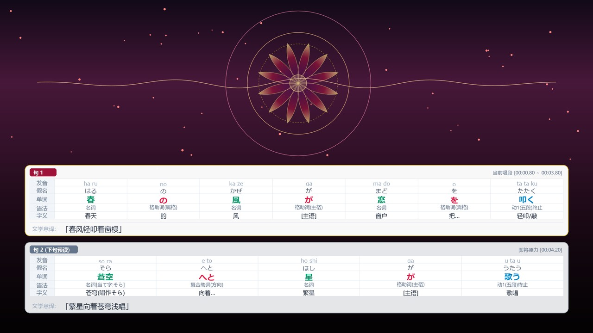
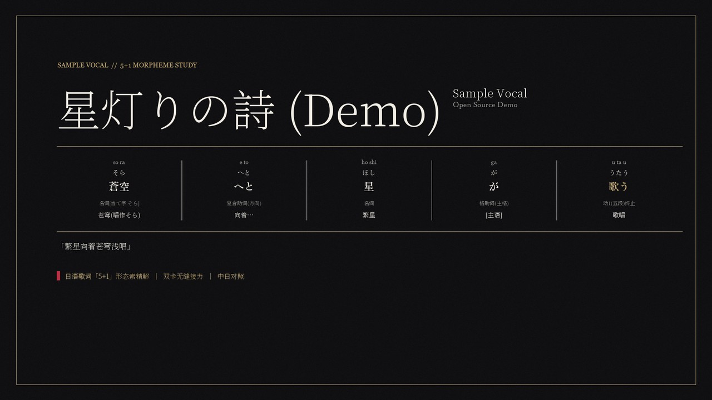

# jp-lyrics-kit

**5+1 Dual-Buffer Japanese-Chinese Morpheme Breakdown Lyrics Video Toolchain & Agent Skill.**  
通用「5+1 双缓冲形态素对照」日语歌词学习视频工具链与跨平台 Agent Skill。




Designed around a clean **AI Semantic Refinement -> Deterministic Rendering** boundary:
- **Offline Drafting (`SudachiPy` + `pykakasi`, optional `faster-whisper`)**: parses `.lrc` / `.srt` / `.txt` (including inline ateji ruby like `扉（ドア）` and paired Chinese `tlyric` tracks) into `song.draft.json` with `needs_review` hints.
- **AI / Human Refinement -> Strict `song.json`**: handles poetic ateji sung readings, classical/historical kana, grammar tags, and literary translation.
- **Deterministic Rendering Engine**:
  - Cross-platform 1080p **5+1 study cards** (`romaji`, `kana`, `word` POS-colored, `pos`, `gloss`, + literary translation) with auto font-shrinking for dense lines.
  - **Offline HTML Proofing Workbench** (`workbench.html`) with synchronized `<audio>` playback and `needs_review` highlighting.
  - **Dual-Buffer Alpha Track Export** (QuickTime RLE `.mov` `argb`: fast `concat` mode or 60fps smooth Slot B -> Slot A upward relay glide).
  - **Audio-Reactive Master MP4 Rendering** (4-band + spectral flux `.npz` envelopes, `preset` SVG/OpenCV themes, `external` video overlay, or bespoke per-song `ScenePlugin` scripts).
  - **16:9 & 4:3 Editorial Cover Generator** with feathered square artwork and highlight 5+1 card preview.

---

## 1. Prerequisites

1. **Python 3.10+**
2. **FFmpeg & FFprobe** on `PATH`:
   - Windows: `winget install Gyan.FFmpeg`
   - macOS: `brew install ffmpeg`
   - Ubuntu / Debian: `sudo apt install ffmpeg`
3. **CJK Fonts**:
   - Windows & macOS include built-in Japanese/Chinese fonts (`Meiryo`/`Microsoft YaHei`, `Hiragino`/`PingFang`).
   - Linux / headless servers: install Noto CJK (`sudo apt install fonts-noto-cjk` or `fonts-noto-cjk-extra`).
   - Custom overrides are supported via `--font-jp-bold`, `--font-jp-reg`, `--font-cn-bold`, `--font-cn-reg` or env vars `JP_LYRICS_KIT_FONT_*`.

---

## 2. Installation

Clone this repository and install the Python package:

```bash
git clone https://github.com/lapland15112251414/jp-lyrics-kit.git
cd jp-lyrics-kit
pip install -e .
```

Optional plain-text timestamp alignment via `faster-whisper`:

```bash
pip install -e ".[whisper]"
```

Verify your setup:

```bash
python -m jp_lyrics_kit doctor
```

---

## 3. Installing the Bundled Agent Skill

Copy [`skills/jp-lyrics-kit/`](./skills/jp-lyrics-kit/) into your coding agent's skills directory:

- **Universal / Cross-agent workspace**: `.agents/skills/jp-lyrics-kit/`
- **Antigravity (Global)**: `~/.gemini/config/skills/jp-lyrics-kit/`
- **Claude Code / Codex**: `~/.claude/skills/jp-lyrics-kit/` or `~/.codex/skills/jp-lyrics-kit/`

Once installed, prompt your agent with an audio file and lyrics (e.g., *"Create a 5+1 Japanese-Chinese lyrics study video from song.flac and lyrics.lrc"*), and it will run `doctor`, `draft`, refine ateji/grammar into `song.json`, verify via `validate --strict` + `workbench.html`, and render the video cleanly.

---

## 4. Quick Start & CLI Reference

Try the built-in 8-second demo in [`examples/minimal_demo/`](./examples/minimal_demo/):

```bash
python -m jp_lyrics_kit validate examples/minimal_demo/song.json --strict
python -m jp_lyrics_kit preview examples/minimal_demo/song.json -o workbench.html
python -m jp_lyrics_kit cover examples/minimal_demo/song.json -o cover_16x9.png --out-4x3 cover_4x3.png
```

Available CLI subcommands (`python -m jp_lyrics_kit <command> --help`):

| Command | Purpose |
| :--- | :--- |
| `doctor` | Check Python deps, FFmpeg/FFprobe binaries, and resolved CJK fonts (`--json` supported) |
| `init <dir>` | Scaffold a project workspace (`output_cards/`, `previews/`, `deliverables/`, `scene_plugin.example.py`) |
| `draft` | Generate `song.draft.json` from `.lrc`/`.srt`/`.txt` using SudachiPy + pykakasi (or `--whisper`) |
| `validate <song.json>` | Validate schema, ascending timestamps, and strict AI completion (`--strict`) |
| `preview <song.json>` | Generate an offline self-contained interactive HTML proofing workbench |
| `cards <song.json>` | Batch render transparent 1080p active/buffer 5+1 PNG cards |
| `alpha <song.json>` | Export transparent QuickTime RLE (`qtrle`/`argb`) `.mov` (`--mode concat` or `smooth`) |
| `audio-env <audio>` | Extract smoothed 60fps `sub`/`mid`/`high`/`rms`/`flux` envelopes into `.npz` |
| `render <song.json>` | Composite `preset`, `external`, or `plugin` backgrounds + smooth dual-buffer cards + audio to MP4 |
| `cover <song.json>` | Render `16:9` (and optional `--out-4x3`) editorial covers |

---

## 5. Writing a Custom `ScenePlugin`

`jp-lyrics-kit init` creates a starter `scene_plugin.example.py`:

```python
import numpy as np

class ScenePlugin:
    def __init__(self, song_data: dict, envs: dict[str, np.ndarray]) -> None:
        self.song_data = song_data
        self.envs = envs

    def render_frame(self, t: float, env: dict[str, float], card_vis: float) -> np.ndarray:
        # Return a 1920x1080 BGR uint8 numpy array.
        # `env` provides audio-reactive floats: sub, mid, high, rms, flux (~0..1).
        # `card_vis` in [0, 1] indicates lower-third card visibility.
        frame = np.zeros((1080, 1920, 3), dtype=np.uint8)
        frame[:, :] = (24, 14, int(min(255, 40 + 140 * env.get("rms", 0.0))))
        return frame
```

Test keyframe stills and a short clip before full rendering:

```bash
python -m jp_lyrics_kit render song.json --audio song.flac --env audio_envelopes.npz \
  --bg-mode plugin --plugin scene_plugin.py \
  --preview-dir previews --preview-times 15 45 90 --max-duration 6 -o test_clip.mp4
```

---

## 6. Running Tests

```bash
python -m unittest discover -s tests -v
```
